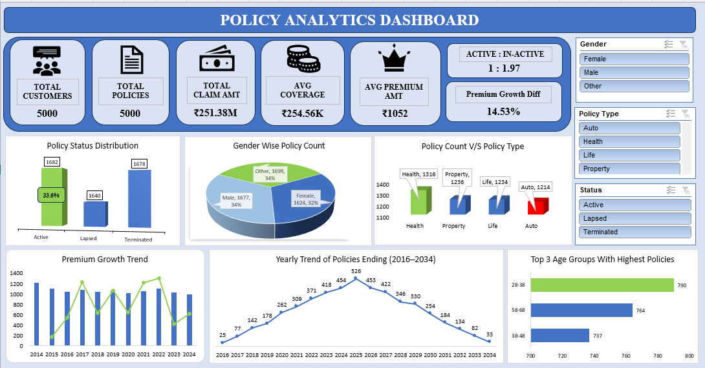
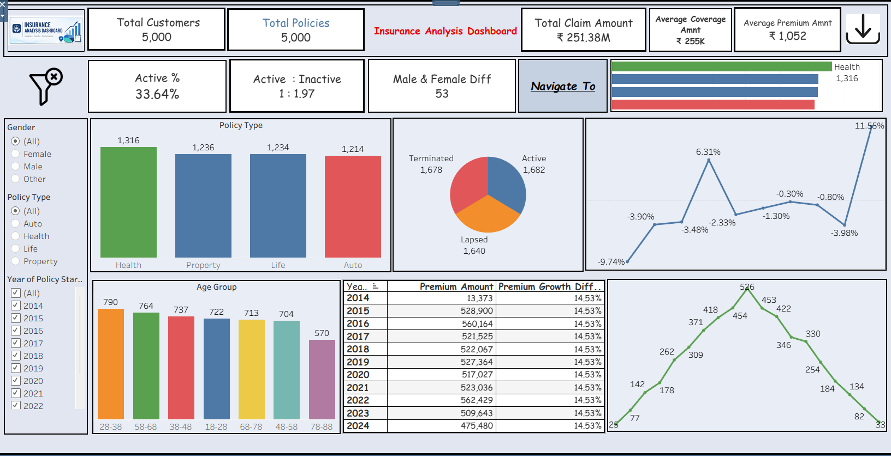
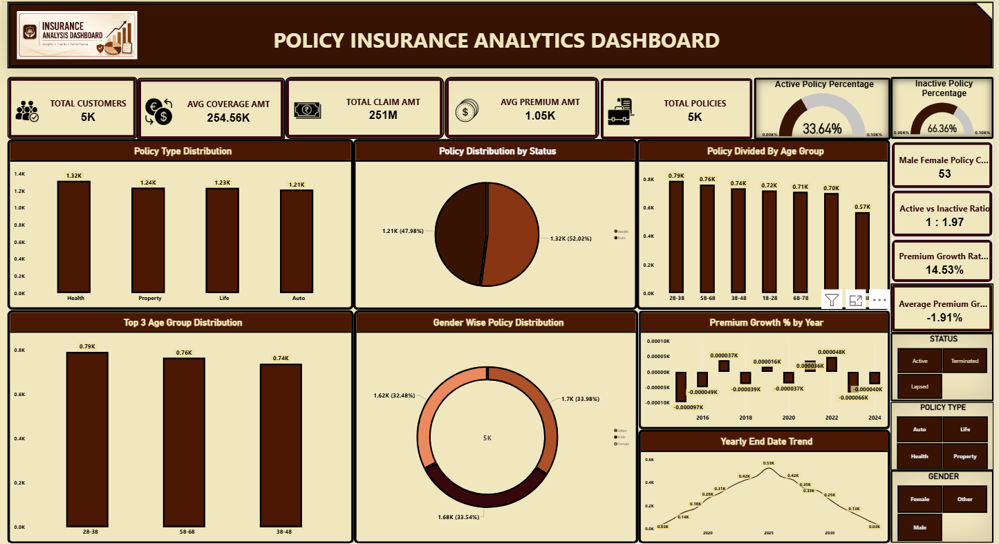

# Insurance Data Analysis Project

## 📌 Project Overview

This project focuses on analyzing insurance business data to gain insights into policy performance, customer demographics, payment trends, and overall business performance.

The project involves data cleaning, data transformation, exploratory data analysis, KPI calculations, and interactive dashboard development using SQL, Microsoft Excel, Tableau, and Power BI.

## 🎯 Project Objectives

- Analyze insurance policy performance and customer distribution.
- Identify trends in insurance payments and premium collections.
- Evaluate policy status and customer demographics.
- Track key performance indicators (KPIs).
- Identify business trends and actionable insights.
- Develop interactive dashboards for data-driven decision-making.

## 🛠️ Tools & Technologies

| Tool | Purpose |
|---|---|
| SQL (MySQL) | Data extraction, cleaning, joins, and KPI analysis |
| Microsoft Excel | Data cleaning, formulas, Pivot Tables, and dashboard |
| Tableau | Interactive visualizations and business dashboards |
| Power BI | Data modeling, DAX measures, and interactive reporting |

## 📂 Project Structure

## 📊 Key Performance Indicators (KPIs)

- Total Number of Customers
- Total Number of Insurance Policies
- Total Premium Amount
- Total Coverage Amount
- Total Claim Amount
- Policy Status Analysis
- Premium Payment Analysis
- Customer Demographic Analysis
- Policy Type Distribution

## 🔍 SQL Analysis

Performed SQL-based analysis using:

- SELECT, WHERE, GROUP BY, and HAVING
- Joins and subqueries
- Aggregate functions
- Common Table Expressions (CTEs)
- Window functions
- CASE statements
- Data cleaning and transformation

## 📈 Excel Analysis

- Data cleaning and preprocessing.
- Handling missing values and duplicate records.
- Applying Excel formulas and functions.
- Creating Pivot Tables and Pivot Charts.
- Developing an interactive Excel dashboard.

## 📊 Tableau Dashboard

- Developed interactive visualizations.
- Analyzed insurance policy performance.
- Created KPI charts and trend analysis.
- Used filters and interactive dashboard elements.

## 📉 Power BI Dashboard

- Built interactive business dashboards.
- Created data models and relationships.
- Developed DAX measures for KPI calculations.
- Used slicers, cards, charts, and filters for business analysis.

## 💡 Business Insights

The analysis focuses on identifying:

- Customer distribution across different demographics.
- Insurance policy performance and distribution.
- Premium collection trends.
- Claim amount patterns.
- Policy-wise business performance.
- Opportunities to improve insurance business operations.

*Add your actual findings and numerical results here.*

## 📸 Dashboard Previews

### Excel Dashboard
## Excel Dashboard

### Tableau Dashboard

### Power BI Dashboard

## 📚 Skills Demonstrated

- Data Analysis
- Data Cleaning and Transformation
- Exploratory Data Analysis (EDA)
- SQL Query Writing
- Excel Dashboard Development
- Data Visualization
- Business Intelligence
- KPI Reporting
- Analytical and Problem-Solving Skills

## 🏁 Conclusion

This project provided practical experience in analyzing insurance business data using multiple data analytics tools. By integrating SQL, Excel, Tableau, and Power BI, the project demonstrates the complete data analytics workflow, from data preparation to visualization and business insights.

## 👨‍💻 Author

**Vankayalapati Sumanth **

Aspiring Data Analyst

**Technical Skills:** SQL | Excel | Power BI | Tableau | Python

**GitHub:** https://github.com/sumanthvankayalapati

**LinkedIn:**www.linkedin.com/in/vankayalapati-sumanth-60562626a
